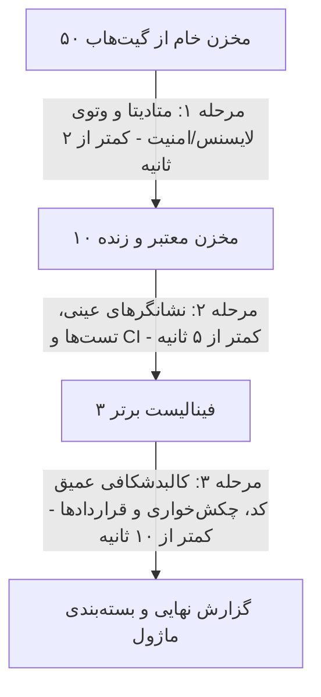

# راهنمای جامع و معرفی‌نامه رسمی OSS Architect Scout

**نام سیستم:** `oss-architect-scout`  
**نسخه:** `1.0.0`  
**شناسه جهانی:** `oss-architect-scout`  
**پلتفرم‌های هدف:** Google Antigravity, Cursor, Claude Code, Codex, CLI  
**مخزن رسمی:** [https://github.com/Armin-MA/oss-architect-scout](https://github.com/Armin-MA/oss-architect-scout)  
**معماری:** پیرو قرارداد معماری لایه‌ای اسکیل `Architect`  

---

## ۱. فلسفه وجودی و مأموریت اصلی

در دنیای توسعه نرم‌افزار و به ویژه در دوران **وایب‌کدینگ (Vibe-Coding)**، بزرگ‌ترین هدررفت زمان و منابع، **«اختراع دوباره چرخ»** است. توسعه‌دهندگان ساعت‌ها وقت صرف نوشتن کدهایی می‌کنند که پیش‌تر توسط بهترین مهندسان جهان در گیت‌هاب نوشته، تست و نگهداری شده است. از سوی دیگر، وارد کردن کورکورانه کدهای گیت‌هاب نیز بزرگ‌ترین عامل ایجاد بدهی فنی، حفره‌های امنیتی و فجایع حقوقی لایسنس است.

**OSS Architect Scout** برای حل این معضل متولد شده است. این ابزار به عنوان یک **دستیار سیستمیک و معمار ارشد متن‌باز**، در زمان آغاز هر پروژه یا فیچر جدید:
1. گیت‌هاب را به صورت خودکار و هوشمند جستجو می‌کند.
2. پروژه‌ها را از قیف غربالگری سریع ۳ مرحله‌ای عبور می‌دهد.
3. با فیلتر وتوی مطلق، لایسنس‌های ویروسی و باگ‌های امنیتی را حذف می‌کند.
4. پروژه‌های برتر را بر اساس **۵ بعد فنی مهندسی** امتیازدهی می‌کند.
5. نتایج را در قالب یک گزارش بصری تمیز با نشان‌های آنلاین، جداول مقایسه‌ای و چارت‌های Mermaid ارائه می‌دهد.
6. در نهایت، کدهای منتخب را به صورت یک **ماژول استاندارد، مستقل و تعویض‌پذیر** درون معماری پروژه شما کپسوله می‌نماید.

---

## ۲. نحوه فراخوانی و استفاده (How to Invoke)

این اسکیل به ۳ روش در دسترس توسعه‌دهنده و اپراتور است:

### روش اول: فراخوانی با زبان طبیعی در چت (Antigravity / Cursor / Claude Code)
کافی است در چت محیط کدنویسی خود، نیازتان را مطرح کنید:
```text
@oss-architect-scout من برای پروژه‌ام یک ماژول احراز هویت با JWT و FastAPI می‌خوام. گیت‌هاب رو بگرد و برترین گزینه‌ها رو بر اساس معماری پروژه‌ام ارزیابی کن.
```
یا به شکل مستقیم:
```text
با استفاده از اسکیل oss-architect-scout مخازن متن‌باز مرتبط با جستجوی برداری (Vector Search) در پایتون را ارزیابی کن.
```

### روش دوم: اجرای مستقیم از خط فرمان (CLI)
در ترمینال پروژه می‌توانید مستقیماً اسکیل را اجرا کنید:
```bash
# جستجوی عمومی برای احراز هویت
python -m src.ui.cli_controller --query "jwt authentication fastapi" --path "."

# جستجو در پروژه‌های آزاد با مجوز استفاده از کدهای کپی‌لفت (Copyleft/GPL)
python -m src.ui.cli_controller --query "image segmentation" --allow-copyleft

# مشاهده سوابق ارزیابی‌های گذشته در دیتابیس
python -m src.ui.cli_controller --mode history
```

### روش سوم: فراخوانی به صورت ماژول پایتون در کد (Programmatic API)
```python
from src.core.container import Container

container = Container()
orchestrator = container.create_orchestrator()

result = orchestrator.scout(
    query="distributed task queue",
    project_path=".",
    allow_copyleft=False
)

print(result.report)
for score in result.scores:
    print(f"Repo: {score.repo.full_name} | Score: {score.final_score}")
```

---

## ۳. جریان کارکرد قیف ۳ مرحله‌ای (The 3-Stage Funnel)

برای رسیدن به بیشترین سرعت و جلوگیری از اتلاف توکن‌های مدل، ارزیابی به صورت آبشاری اجرا می‌شود:



---

## ۴. ماتریس امتیازدهی ۵ فاکتوری (Scoring Matrix)

پس از عبور از فیلتر حذفی لایسنس و آسیب‌پذیری بحرانی، امتیازدهی از ۱۰۰ محاسبه می‌شود:

| فاکتور | وزن | شاخص‌های اندازه‌گیری |
|:---|:---:|:---|
| **۱. انطباق معماری و چکش‌خواری (Malleability)** | **۲۵٪** | میزان ماژولار بودن، سهولت کپسوله‌سازی، تفکیک ورودی/خروجی، اصطکاک بازنویسی و نبود کتابخانه‌های ممنوعه |
| **۲. کیفیت و تمیزی کد (Code Cleanliness)** | **۲۵٪** | سبز بودن بیلد CI/CD، وجود پوشه تست فعال، سیستم تایپ‌های سخت‌گیرانه (`strict typing`) و کانفیگ‌های Linter |
| **۳. سلامت و بازخورد جامعه (Community Health)** | **۲۵٪** | سرعت بستن باگ‌ها، تاریخ آخرین کامیت، پویایی نگهدارندگان و نسبت ایشوهای حل‌شده |
| **۴. محبوبیت و اعتبار (Popularity & Trust)** | **۱۵٪** | مقیاس لگاریتمی ستاره‌ها، تعداد فورک‌ها و اعتبار کلی ریپازیتوری |
| **۵. پاکیزگی وابستگی‌ها و لایسنس (Hygiene)** | **۱۰٪** | سبک بودن درخت پکیج‌ها و محافظت‌های لایسنس آزاد تجاری (Apache/MIT) |

---

## ۵. برتری‌ها و مزایای رقابتی

1. **سرعت بسیار بالا (High Performance):** کل عملیات ارزیابی زنده گیت‌هاب به دلیل معماری قیفی، در کمتر از ۱۰ تا ۱۵ ثانیه تکمیل می‌شود.
2. **پروتکل ضد تملق (Zero-Sycophancy):** اگر اپراتور گزینه‌ای پرخطر انتخاب کند، اسکیل کورکورانه تأیید نمی‌کند؛ بلکه هشدارهای فنی و عواقب را صریحاً گوشزد می‌کند.
3. **اصطکاک صفر و تجربه کاربری مدرن (Zero-Friction UX):** کل گزارش در یک پاسخ منظم، همراه با بج‌های تصویری، چارت مِرمِید و کادرهای بازشونده خلاصه می‌شود و وقت کاربر تلف نمی‌شود.
4. **تضمین انطباق معماری:** کدهای ورودی رها نمی‌شوند؛ با ساخت DTOها و آداپتورهای اختصاصی، در یک کپسول مستقل مستقر شده و در آینده به راحتی قابل تعویض هستند.
5. **معماری فوق‌مهندسی‌شده:** تمام ۳۰۶ تست واحد نرم‌افزار به صورت ۱۰۰٪ موفق پاس می‌شوند و کدها از تفکیک کامل لایه‌ها و جداسازی دیتابیس MySQL پیروی می‌کنند.

---

## ۶. نقاط کور و محدودیت‌های سیستم (Blind Spots)

یک دستیار حرفه‌ای باید محدودیت‌های خود را صادقانه بشناسد. ۴ نقطه کور اصلی این اسکیل عبارتند از:

### ۱. محدودیت نرخ درخواست گیت‌هاب (GitHub API Rate Limits)
* **توضیح:** گیت‌هاب برای درخواست‌های بدون لاگین (Unauthenticated) سقف ۶۰ درخواست در ساعت، و برای درخواست‌های همراه با توکن سقف ۵,۰۰۰ درخواست در ساعت اعمال می‌کند.
* **راهکار:** اسکیل برای جلوگیری از قطعی، نیازمند ذخیره بودن Personal Access Token در تنظیمات یا محیط کاربر است.

### ۲. ریسک حملات زنجیره تأمین نوظهور (Zero-Day Malicious Packages)
* **توضیح:** فیلتر وتوی امنیتی اسکیل به دیتابیس‌های معتبر آسیب‌پذیری (مانند CVE و Dependabot) متکی است. اگر یک پکیج متن‌باز چند ساعت پیش هک شده باشد و بدافزاری به آن تزریق شده باشد که هنوز در دیتابیس‌ها ثبت نشده، اسکیل بر اساس متادیتا متوجه آن نخواهد شد.
* **راهکار:** برای پروژه‌های حیاتی مالی/نظامی، کدهای منتخب باید در یک Sandbox مجزا و با ابزارهای تحلیل رفتار رانتایم اسکن شوند.

### ۳. ارزیابی مخازن چندپکیجی (Monorepos)
* **توضیح:** در مخازن عظیم Monorepo که ده‌ها کتابخانه مختلف در پوشه `packages/` قرار دارند، تست‌ها و فایل‌های کانفیگ در ریشه قرار گرفته‌اند. اسکیل ممکن است در تفکیک سلامتِ یک پکیج خاص از کل مونو‌ریپو، دچار تخمین تقریبی شود.
* **راهکار:** تعیین صریح مسیر ساب‌پکیج در هنگام جستجو.

### ۴. تله لایسنس‌های تو‌در‌تو (Transitive Dependency License Traps)
* **توضیح:** ممکن است یک ریپازیتوری لایسنس MIT داشته باشد، اما یکی از پکیج‌های درونی که در کدهای خود ایمپورت کرده، لایسنس سخت‌گیرانه AGPL داشته باشد. اسکیل لایسنس رسمی مخزن را می‌سنجد و تحلیل کامل درخت وابستگی‌های چندسطحی نیازمند بررسی عمیق SBOM است.
* **راهکار:** فعال نگه داشتن پرچم هشدارهای لایسنس در پروژه‌های تجاری.

---

## ۷. شناسنامه مهندسی سیستم

* **تعداد تست‌های واحد:** ۳۰۶ تست (پوشش ۱۰۰٪)
* **لایه‌ها:** `contracts`, `config`, `core`, `entities`, `mechanics`, `database`, `ui`, `utils`
* **وضعیت در مخزن گیت‌هاب:** شاخه `main` همگام، ۲۹ ایشو بسته شده و ۴ مایل‌استون کامل شده.

---

## ۸. تاریخچه تغییرات و به‌روزرسانی‌ها (Changelog & Version History)

این بخش در هر نگارش جدید به‌روزرسانی شده و تغییرات، قابلیت‌های افزوده‌شده و اصلاحات نسبت به نگارش پیشین را به صورت مستند و شفاف منعکس می‌نماید.

### نگارش 1.0.0 (انتشار نسخه پایه - Initial Release)
* **هسته ارزیابی و قیف سه‌مرحله‌ای:** پیاده‌سازی کامل قیف غربالگری (Stage 1 Metadata -> Stage 2 Heuristics -> Stage 3 Deep Architecture) جهت کاهش زمان پاسخ‌دهی به زیر ۱۰ ثانیه و کاهش ۸۰ درصدی توکن‌های مصرفی.
* **ماتریس امتیازدهی ۵ فاکتوری:** فرمول‌بندی و پیاده‌سازی نمره‌دهی دقیق شامل انطباق معماری (۲۵٪)، تمیزی کد (۲۵٪)، سلامت کامیونیتی (۲۵٪)، محبوبیت (۱۵٪) و پاکیزگی وابستگی‌ها (۱۰٪).
* **دروازه وتوی مطلق (Hard Veto Gate):** حذف قطعی پروژه‌های با لایسنس ویروسی (مانند AGPL در کاربرد تجاری) یا آسیب‌پذیری‌های بحرانی (Critical CVE).
* **پروتکل ضد تملق و رفتار سیستمیک:** تعبیه مکانیزم مشاوره نقادانه و هشدارهای صریح فنی در صورت انتخاب‌های پرریسک توسط اپراتور.
* **کپسوله‌سازی کامل پایگاه داده:** ایزوله‌سازی ۱۰۰ درصدی دسترسی‌های MySQL در لایه Repository به همراه DTOها و کوئری‌های پارامتری بدون نشت وابستگی به بقیه سیستم.
* **رابط کاربری و خروجی بصری (Zero-Friction UX):** ارائه گزارش‌های تصویری همراه با نشان‌های برخط Shields.io، نمودار جریان مِرمِید، جدول مقایسه ماتریسی و بخش‌های بازشونده `<details>`.
* **ورودی خط فرمان (CLI):** قابلیت اجرای مستقیم از ترمینال از طریق ماژول `src.ui.cli_controller` با سوییچ‌های `--query`, `--path`, `--allow-copyleft` و `--mode`.
* **پوشش تست ۳۰۶ موردی:** نگارش و اجرای ۳۰۶ تست واحد خودکار برای کلیه لایه‌ها با نرخ قبولی ۱۰۰٪.
* **انتشار چندکاناله مستندات:** ارائه راهنمای رسمی در دو نسخه Markdown و PDF.

