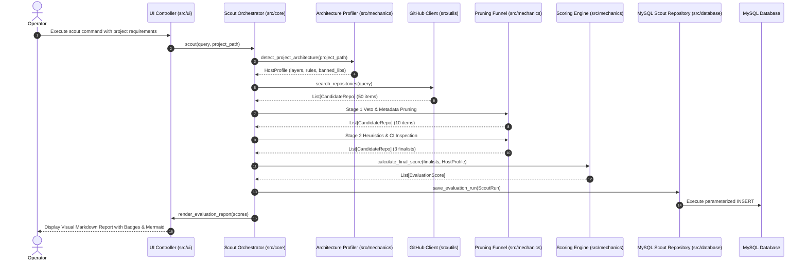
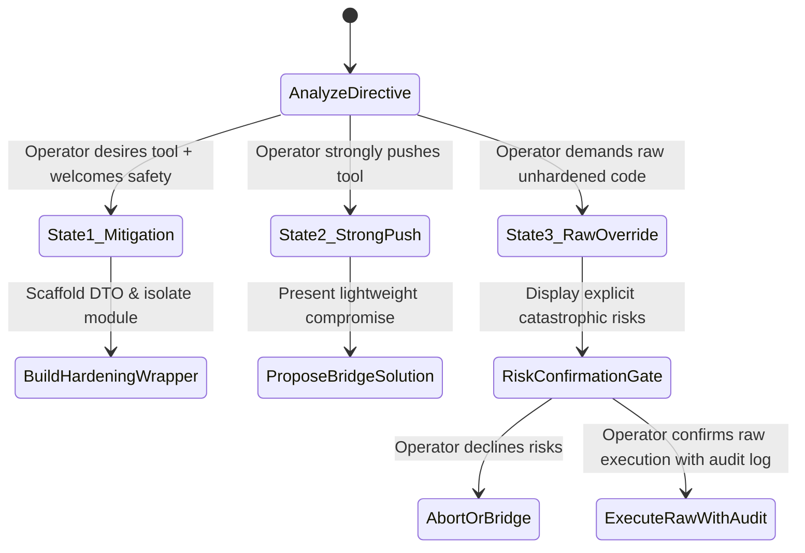

# System Architecture & Contracts Specification: OSS Architect Scout

**Project Name:** `oss-architect-scout`  
**Governing Standard:** `interactive-architect-gatekeeper` (Version 2.0.0)  
**Status:** Locked at DoD Gate 2  
**Target Milestone:** Milestone 2: Architecture & Contracts  

---

## 1. Architectural Philosophy & Layered Blueprint

The system enforces strict decoupling, Inversion of Control (IoC), "One File, One Logical Action" in mechanics, pure domain modeling, and total MySQL database isolation.

```text
src/
├── contracts/     # Pure abstract interfaces/protocols. ZERO runtime execution logic.
├── config/        # Environment constants and static settings. ZERO conditional logic.
├── core/          # IoC container and application bootstrap. No business logic.
├── entities/      # Pure domain models. ZERO framework/database/UI dependencies.
├── mechanics/     # Deterministic business algorithms. Pure functions, one file per action.
├── database/      # Total MySQL isolation (models, DTOs, queries, repositories).
├── ui/            # Visual presenters and CLI controllers. No business algorithms.
└── utils/         # Cross-cutting deterministic helpers (formatters, classifiers).
```

---

## 2. Layer Contracts & Boundary Interfaces (`src/contracts/`)

Every cross-boundary interaction is mediated strictly by an abstract contract:

```mermaid
classDiagram
    direction TB
    class IGitHubClient {
        <<interface>>
        +search_repositories(query: str, limit: int) List~CandidateRepo~
        +get_repository_tree(full_name: str) List~str~
        +get_file_content(full_name: str, path: str) str
        +check_ci_status(full_name: str) str
    }

    class IArchitectureProfiler {
        <<interface>>
        +profile_host(project_path: str) HostProfile
    }

    class IPruningFunnel {
        <<interface>>
        +prune_stage1_metadata(repos: List~CandidateRepo~) List~CandidateRepo~
        +prune_stage2_heuristics(repos: List~CandidateRepo~, client: IGitHubClient) List~CandidateRepo~
        +prune_stage3_deep(repos: List~CandidateRepo~, host: HostProfile) List~CandidateRepo~
    }

    class IScoringEngine {
        <<interface>>
        +score_candidate(repo: CandidateRepo, host: HostProfile) EvaluationScore
    }

    class IScoutRepository {
        <<interface>>
        +save_evaluation_run(run: ScoutRun) str
        +get_evaluation_history(limit: int) List~EvaluationRecordDTO~
    }

    class IUIPresenter {
        <<interface>>
        +render_evaluation_report(scores: List~EvaluationScore~) str
        +render_risk_confirmation(repo: CandidateRepo, risks: List~str~) str
    }
```



### 2.1 Interface Invariants
* Zero runtime logic inside `src/contracts/`.
* No layer imports concrete implementations from other layers; wiring occurs solely in `src/core/container.py`.

---

## 3. Data Lifecycle & Interaction Flow

The complete flow from user invocation to evaluation and persistence:



---

## 4. MySQL Relational Database Design & Total Encapsulation

### 4.1 Schema Definition (`src/database/queries/evaluation_queries.py`)

All table interactions occur via isolated parameterized SQL statements:

```sql
CREATE TABLE IF NOT EXISTS scout_runs (
    id VARCHAR(36) PRIMARY KEY,
    query VARCHAR(255) NOT NULL,
    host_architecture VARCHAR(100) NOT NULL,
    total_candidates INT NOT NULL,
    finalists_count INT NOT NULL,
    created_at TIMESTAMP DEFAULT CURRENT_TIMESTAMP,
    INDEX idx_scout_query (query),
    INDEX idx_created_at (created_at)
) ENGINE=InnoDB DEFAULT CHARSET=utf8mb4 COLLATE=utf8mb4_unicode_ci;

CREATE TABLE IF NOT EXISTS candidate_evaluations (
    id VARCHAR(36) PRIMARY KEY,
    run_id VARCHAR(36) NOT NULL,
    repo_full_name VARCHAR(150) NOT NULL,
    stars INT NOT NULL,
    license_type VARCHAR(50) NOT NULL,
    veto_passed BOOLEAN NOT NULL,
    community_score DECIMAL(5,2) NOT NULL,
    cleanliness_score DECIMAL(5,2) NOT NULL,
    architecture_score DECIMAL(5,2) NOT NULL,
    popularity_score DECIMAL(5,2) NOT NULL,
    hygiene_score DECIMAL(5,2) NOT NULL,
    final_score DECIMAL(5,2) NOT NULL,
    strengths TEXT,
    weaknesses TEXT,
    created_at TIMESTAMP DEFAULT CURRENT_TIMESTAMP,
    FOREIGN KEY (run_id) REFERENCES scout_runs(id) ON DELETE CASCADE,
    INDEX idx_repo_score (repo_full_name, final_score)
) ENGINE=InnoDB DEFAULT CHARSET=utf8mb4 COLLATE=utf8mb4_unicode_ci;
```

### 4.2 Data Transfer Objects (`src/database/dto/`)
* **`EvaluationRecordDTO`**: Crosses the repository boundary to transport persistence records to the core without exposing database rows or driver internals.
* **Encapsulation Rule:** The application never imports MySQL connection handles, cursor objects, or drivers outside `src/database/repositories/`.

---

## 5. Pure Mechanics Layer (`src/mechanics/`)

Conforming strictly to the **"One File, One Logical Action"** rule:
1. `filter_veto_gate.py`: Evaluates hard veto constraints (license permissiveness, Critical CVEs). Returns `VetoResult`.
2. `calculate_community_score.py`: Computes community health score (0-100) from issue velocity and commit recency.
3. `calculate_code_cleanliness_score.py`: Computes code quality score (0-100) from test presence, CI status, and strict typing.
4. `calculate_popularity_score.py`: Computes normalized popularity score (0-100) from stars and fork ratios.
5. `calculate_malleability_score.py`: Computes architectural elasticity and refactoring friction (0-100).
6. `calculate_final_score.py`: Computes the weighted aggregate:  
   $$\text{Final} = 0.25 \times S_{\text{arch}} + 0.25 \times S_{\text{clean}} + 0.25 \times S_{\text{comm}} + 0.15 \times S_{\text{pop}} + 0.10 \times S_{\text{hyg}}$$
7. `detect_project_architecture.py`: Pure scanner constructing a `HostProfile` from project files.
8. `generate_adapter_scaffold.py`: Produces swappable interface and DTO wrappers for imported code.

---

## 6. Zero Confirmation Bias & Tri-State Intent Handler

The decision matrix for handling operator directives:



---

## 7. Configuration & Environment (`src/config/settings.py`)
Static constants with **zero conditional logic**:
* Default scoring weights: `[25, 25, 25, 15, 10]`
* GitHub API Base URL: `https://api.github.com`
* Maximum search limit: `50`
* Stage 2 finalist limit: `3`
* Database connection configuration (host, port, user, password, database).
