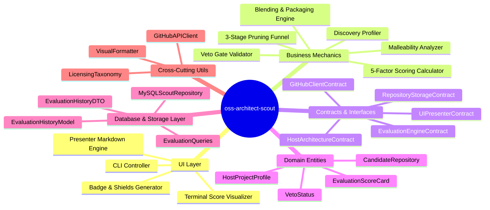
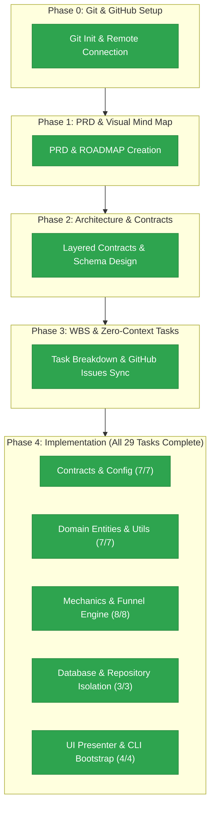

# Project Roadmap & System Mind Map: OSS Architect Scout

## 1. System Mind Map

---

## 2. Component Implementation Status

---

## 3. High-Level Milestone Progress

- [x] **Milestone 0:** Git Initialized & GitHub Remote Connected (`Armin-MA/oss-architect-scout`)
- [x] **Milestone 1:** Scope & PRD Finalized (`specs/PRD.md` & `specs/ROADMAP.md` at Gate 1)
- [x] **Milestone 2:** Architecture & Contracts Locked (`specs/ARCHITECTURE.md` at Gate 2)
- [x] **Milestone 3:** WBS, Zero-Context Tasks & GitHub Issues Synced (`specs/WBS.md` at Gate 3)
- [x] **Milestone 4:** Gated Implementation & Verification (`START_IMPLEMENTATION`)
  - [x] Layer 1: Contracts & Config (TASK-001 to TASK-007)
  - [x] Layer 2: Entities & Utils (TASK-008 to TASK-014)
  - [x] Layer 3: Pure Mechanics (TASK-015 to TASK-022)
  - [x] Layer 4: Database & Encapsulation (TASK-023 to TASK-025)
  - [x] Layer 5: UI & Presentation (TASK-026 to TASK-029)
